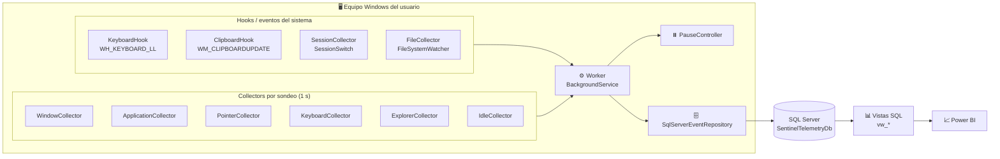
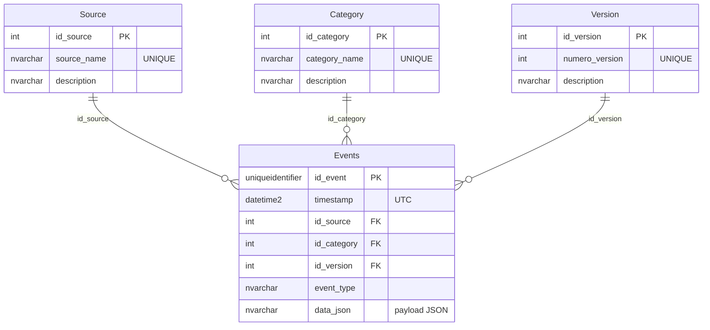

<div align="center">

# 🛰️ SentinelTelemetry

**Telemetría de actividad de usuario para Windows — captura, persiste y analiza.**

Un servicio de bandeja que observa cómo se usa realmente un equipo: qué aplicaciones se abren,
cuánto tiempo están en primer plano, cuánto se teclea, dónde se hace clic, qué se copia y qué
archivos se tocan. Todo se guarda en **SQL Server** en un modelo de eventos extensible y se
expone con **vistas SQL** listas para **Power BI**.

[](https://dotnet.microsoft.com/)
[](#requisitos)
[](#-modelo-de-datos)
[](#-dashboard-power-bi)
[](./LICENSE)
[](#-stack-tecnológico)
[](#-roadmap)

</div>

---

## 📖 Tabla de contenidos

- [¿Qué es SentinelTelemetry?](#-qué-es-sentineltelemetry)
- [Características](#-características)
- [Arquitectura](#-arquitectura)
- [Stack tecnológico](#-stack-tecnológico)
- [Estructura del repositorio](#-estructura-del-repositorio)
- [Requisitos](#-requisitos)
- [Puesta en marcha](#-puesta-en-marcha)
- [Catálogo de eventos](#-catálogo-de-eventos)
- [Modelo de datos](#-modelo-de-datos)
- [Vistas SQL](#-vistas-sql)
- [Dashboard Power BI](#-dashboard-power-bi)
- [Uso en Power BI](#-uso-en-power-bi)
- [Extender con un nuevo collector](#-extender-con-un-nuevo-collector)
- [Privacidad y datos sensibles](#-privacidad-y-datos-sensibles)
- [Roadmap](#-roadmap)
- [Contribuir](#-contribuir)
- [Licencia](#-licencia)

---

## 🎯 ¿Qué es SentinelTelemetry?

**SentinelTelemetry** es una plataforma de **telemetría local** (single-machine) que responde
preguntas como:

- ¿Qué aplicaciones se usan más y por cuánto tiempo están en primer plano?
- ¿Qué tan rápido y cuánto se escribe cada día?
- ¿En qué zonas de la pantalla se concentran los clics?
- ¿Qué carpetas se navegan y qué archivos se crean, renombran o eliminan?
- ¿Cuánto tiempo real de actividad hay frente al tiempo inactivo?
- ¿Qué aplicaciones se abren al iniciar sesión y cómo se salta de una app a otra?

En lugar de escribir una tabla por métrica, el proyecto usa un **único modelo de eventos**:
una tabla `Events` con metadatos indexables (`source`, `category`, `event_type`, `timestamp`) y un
**payload JSON** (`data_json`). Añadir una nueva fuente de telemetría no requiere migrar el esquema:
basta con crear un nuevo `Collector` y su modelo. Las **vistas SQL** hacen el trabajo de
"desempaquetar" ese JSON en columnas analíticas.

> 📄 ¿Vas a construir informes? Revisa el documento complementario
> [`DOCUMENTACION_POWERBI.md`](./DOCUMENTACION_POWERBI.md) con el modelo en estrella,
> medidas DAX y consultas de validación.

---

## ✨ Características

| Módulo | Qué captura | Cómo |
|---|---|---|
| 🪟 **Ventana activa** | Aplicación y título de la ventana en primer plano | Sondeo de `GetForegroundWindow` (solo al cambiar) |
| 🚀 **Ciclo de vida de apps** | Apertura y cierre de procesos con ventana visible | Sondeo de `Process` + `MainWindowHandle` |
| ⌨️ **Teclado** | Pulsaciones agregadas por segundo | Hook de bajo nivel (`WH_KEYBOARD_LL`) |
| 🖱️ **Ratón** | Posición, clic izquierdo/derecho y movimiento | `GetCursorPos` + `GetAsyncKeyState` (umbral 4 px) |
| 📋 **Portapapeles** | Tipo de contenido (`Text`/`Image`/`FileDrop`) y longitud | `AddClipboardFormatListener` (`WM_CLIPBOARDUPDATE`) |
| 🗂️ **Explorador** | Carpeta que se está navegando | COM `ShellWindows` |
| 📁 **Archivos** | Creación, borrado, renombrado y modificación | `FileSystemWatcher` en carpetas configuradas |
| 💤 **Inactividad** | Inicio/fin de periodos idle (umbral 30 s) | Máquina de estados sobre actividad de entrada |
| 🔐 **Sesión** | Login, Logout, Lock, Unlock, RemoteConnect/-Disconnect, Suspend, Resume | Eventos del sistema (`SystemEvents`) |
| 🧩 **Control** | Pausar/Reanudar/Cerrar sin cerrar sesión | Icono de bandeja (`NotifyIcon`) |
| 🛡️ **Robustez** | Conexión con reintentos + hooks que no bloquean | Reintento exponencial simple y hilos de mensajes dedicados |

---

## 🏗️ Arquitectura



**Flujo de datos**

1. Los **collectors** producen objetos `EventBase` (con `Source`, `Category`, `EventType`, `Version`).
2. El **Worker** los recoge en un ciclo de **1 segundo**, aplica filtros de ruido y los persiste.
3. El **repositorio** resuelve/crea las claves de catálogo y guarda el evento serializado a JSON.
4. Las **vistas** convierten el JSON en tablas analíticas.
5. **Power BI** consume directamente esas vistas.

---

## 🧰 Stack tecnológico

- **Lenguaje:** C# 14 · **Runtime:** .NET 10 (`net10.0`, `net10.0-windows`)
- **Host del servicio:** `Microsoft.Extensions.Hosting` (Generic Host + `BackgroundService`)
- **Persistencia:** `Microsoft.Data.SqlClient` sobre **SQL Server**
- **Interop Windows:** P/Invoke a `user32`/`kernel32` + COM (`Shell32`, `SHDocVw`)
- **UI de bandeja:** Windows Forms (`NotifyIcon`); proyecto WPF reservado para una UI futura
- **Analítica:** T-SQL (vistas) → Power BI

---

## 📂 Estructura del repositorio

```text
SentinelTelemetry/
├── SentinelTelemetry.slnx                 # Solución (formato slnx)
├── README.md                              # Este archivo
├── DOCUMENTACION_POWERBI.md               # Contexto técnico y de datos
├── PowerBI/
│   ├── SentinelTelemetryReport.pbix       # Informe: 4 páginas, 36 medidas
│   └── GUIA_MEDIDAS_DAX.md                # Paso a paso de DAX y páginas
│
├── SentinelTelemetry.Core/                # 📦 Modelos e interfaces (net10.0)
│   ├── Models/
│   │   ├── EventBase.cs                   # Clase base de todos los eventos
│   │   ├── WindowEvent.cs  ApplicationEvent.cs  PointerEvent.cs
│   │   ├── KeyboardEvent.cs  ClipboardEvent.cs  ExplorerEvent.cs
│   │   ├── FileEvent.cs  IdleEvent.cs  SessionEvent.cs
│   └── Interfaces/
│       ├── IEventRepository.cs            # SaveEventAsync(EventBase)
│       └── IEventCollector.cs             # Capture() -> EventBase
│
├── SentinelTelemetry.Agent/               # 🎛️ Collectors  (Telemetry.csproj)
│   ├── WindowCollector.cs  ApplicationCollector.cs  PointerCollector.cs
│   ├── KeyboardCollector.cs  KeyboardHook.cs  ClipboardCollector.cs
│   ├── ClipboardHook.cs  ExplorerCollector.cs  FileCollector.cs
│   ├── IdleCollector.cs  SessionCollector.cs  NativeMethods.cs
│
├── SentinelTelemetry.Storage/             # 🗄️ Persistencia  (Persistence.csproj)
│   └── SqlServerEventRepository.cs        # Crea la BD/tablas e inserta eventos
│
├── SentinelTelemetry.Service/             # ⚙️ Servicio Windows (WinExe)
│   ├── Program.cs                         # Host + bandeja + reintentos de conexión
│   ├── Worker.cs                          # Bucle de captura (1 s)
│   ├── PauseController.cs                 # Pausa/Reanudación
│   └── appsettings.json                   # Cadena de conexión + carpetas vigiladas
│
├── SentinelTelemetry.UI/                  # 🖥️ UI WPF (placeholder)
│   └── MainWindow.xaml
│
└── SentinelTelemetry.Database/            # 🧱 Scripts T-SQL
    ├── 01_Schema_Creation.sql
    ├── 02_vw_pointer_unpacked_data.sql
    ├── 03_vw_window_activity_duration.sql
    ├── ... 
    ├── 15_vw_transitions_between_apps.sql
    └── 16_index_events_idle.sql
```

> ℹ️ Nota: algunos nombres de **carpeta** y de **`.csproj`** no coinciden
> (`SentinelTelemetry.Agent` → `SentinelTelemetry.Telemetry.csproj`,
> `SentinelTelemetry.Storage` → `SentinelTelemetry.Persistence.csproj`,
> `SentinelTelemetry.UI` → `SentinelTelemetry.UI.WPF.csproj`).

---

## ✅ Requisitos

| Requisito | Detalle |
|---|---|
| **SO** | Windows 10/11 (usa hooks e interop nativa). |
| **SDK** | [.NET 10 SDK](https://dotnet.microsoft.com/download). |
| **BD** | SQL Server (LocalDB, Express o superior) accesible desde el equipo. |
| **Permisos** | El usuario debe poder ejecutar hooks globales de entrada. |

> ⚠️ **El esquema autoritativo lo crea la aplicación** (`SqlServerEventRepository.EnsureDatabaseAndTableCreated()`).
> El script `01_Schema_Creation.sql` es una referencia manual y difiere en detalles menores
> (no incluye las restricciones `UNIQUE`). Confía en el código si quieres el esquema exacto.

---

## 🚀 Puesta en marcha

### 1. Clonar y compilar

```bash
git clone https://github.com/jordihuaman/SentinelTelemetry.git
cd SentinelTelemetry
dotnet build SentinelTelemetry.slnx
```

### 2. Configurar

Edita `SentinelTelemetry.Service/appsettings.json`:

```jsonc
{
  "ConnectionStrings": {
    "SentinelDb": "Server=.;Database=SentinelTelemetryDb;Trusted_Connection=True;TrustServerCertificate=True;"
  },
  "FileWatcher": {
    "WatchedFolders": [
      "C:\\Users\\<usuario>\\Desktop",
      "C:\\Users\\<usuario>\\Documents",
      "C:\\Users\\<usuario>\\Downloads"
    ],
    "ExcludedFolderNames": [ "node_modules", ".git", "bin", "obj", ".vs" ]
  }
}
```

### 3. Ejecutar

```bash
dotnet run --project SentinelTelemetry.Service
```

- El servicio **crea la base de datos y las tablas automáticamente** si no existen.
- Verás un **icono en la bandeja del sistema** con el menú **Pausar / Reanudar / Cerrar**.
- La captura comienza de inmediato (con un ciclo inicial que fija el estado sin emitir eventos).

### 4. Explorar los datos

```sql
USE SentinelTelemetryDb;

-- Volumen por origen y tipo (últimos 7 días)
SELECT S.source_name, E.event_type, COUNT(*) AS Eventos
FROM dbo.Events E
JOIN dbo.Source S ON S.id_source = E.id_source
WHERE E.timestamp >= DATEADD(DAY, -7, SYSUTCDATETIME())
GROUP BY S.source_name, E.event_type
ORDER BY Eventos DESC;

-- Top aplicaciones por tiempo en primer plano
SELECT TOP 10 Process_Name AS Aplicacion,
       ROUND(SUM(Duration_Seconds) / 3600.0, 2) AS Horas
FROM vw_window_activity_duration
WHERE Duration_Seconds IS NOT NULL
GROUP BY Process_Name
ORDER BY Horas DESC;
```

---

## 📇 Catálogo de eventos

Combinaciones que produce el sistema. El **JSON** guarda las propiedades específicas en
**PascalCase** (además de `Id`, `Timestamp`, `Source`, `Category`, `EventType`, `Version`).

| `Source` | `Category` | `event_type` | Payload JSON |
|---|---|---|---|
| `Window` | `System` | `ActiveWindowSnapshot` | `ProcessName`, `WindowTitle` |
| `Application` | `Lifecycle` | `Opened`, `Closed` | `ProcessName`, `ProcessId`, `WindowTitle` |
| `Pointer` | `Input` | `MouseMove`, `LeftClick`, `RightClick` | `X`, `Y`, `LeftClick`, `RightClick` |
| `Keyboard` | `Input` | `KeyboardSnapshot` | `KeyPressCount` |
| `ClipboardCollector` | `Clipboard` | `ClipboardChanged` | `ContentType`, `ContentLength` |
| `ExplorerCollector` | `Explorer` | `FolderOpened`, `FolderChanged`, `FolderClosed` | `FolderPath` |
| `FileCollector` | `File` | `Created`, `Deleted`, `Renamed`, `Modified` | `FilePath`, `OldFilePath` |
| `Idle` | `Attention` | `IdleStarted`, `IdleEnded` | — |
| `Session` | `System` | `Login`, `Logout`, `Lock`, `Unlock`, `RemoteConnect`, `RemoteDisconnect`, `Suspend`, `Resume` | — |

**Reglas de muestreo** (clave para interpretar los datos):

- ⏱️ El `Worker` cicla cada **1 segundo**.
- 🪟 La ventana se guarda **solo cuando cambia** (`ProcessName` o `WindowTitle`).
- ⌨️ El teclado solo se guarda si `KeyPressCount > 0` (segundos con tecleo).
- 🖱️ El ratón solo se guarda con clic o movimiento **≥ 4 px**.
- 💤 El umbral de inactividad es **30 segundos** sin entrada.
- 🚀/🗂️ App y Explorador **no emiten** en el primer ciclo (fijan la "foto" inicial).

---

## 🗄️ Modelo de datos

Modelo **event-sourcing ligero**: una tabla de hechos + tres catálogos normalizados.



| Tabla | Rol | Notas |
|---|---|---|
| `Events` | **Hecho** | `timestamp` es **UTC** (`DateTime.UtcNow`). |
| `Source` | Dimensión | Origen/collector (se auto-crea). |
| `Category` | Dimensión | Categoría funcional (se auto-crea). |
| `Version` | Dimensión | Versión del esquema del evento (hoy siempre `1`). |

Ejemplo de `data_json`:

```json
{
  "ProcessName": "Code",
  "WindowTitle": "Worker.cs - SentinelTelemetry",
  "Id": "3f2b1c9e-...",
  "Timestamp": "2026-05-01T14:23:11.1234567Z",
  "Source": "Window",
  "Category": "System",
  "EventType": "ActiveWindowSnapshot",
  "Version": 1
}
```

---

## 📊 Vistas SQL

### Vistas de desempaquetado (JSON → columnas)

| Vista | Origen | Columnas de negocio |
|---|---|---|
| `vw_pointer_unpacked_data` | `Pointer` | `PosicionX`, `PosicionY`, `ClicIzquierdo`, `ClickDerecho` |
| `vw_window_unpacked_data` | `Window` | `Aplicacion`, `Ventana_Interna` |
| `vw_keyboard_unpacked_data` | `Keyboard` | `Pulsaciones` |
| `vw_clipboard_unpacked_data` | `ClipboardCollector` | `Tipo_Contenido`, `Longitud_Contenido` |
| `vw_applicationCycle_unpacked_data` | `Application` | `Programa` |
| `vw_explorer_unpacked_data` | `ExplorerCollector` | `Ruta` |
| `vw_fileManagement_unpacked_data` | `FileCollector` | `RutaAnterior`, `RutaActual` |

### Vistas analíticas (métricas)

| Vista | Métrica que produce |
|---|---|
| `vw_window_activity_duration` | `Start_Time`, `End_Time`, `Duration_Seconds` por app (vía `LEAD`). |
| `vw_keyboard_daily_summary` | Pulsaciones por día (**hora Perú, UTC-5**). |
| `vw_keyboard_typing_metrics` | Sesiones de tecleo con **KPS** y **KPM** (gap ≥ 2 s). |
| `vw_pointer_heatmap` | Mapa de calor en *bins* de **10×10 px**. |
| `vw_idle_activity_periods` | Periodos **`Idle`** y **`Activo`** con duración. |
| `vw_apps_when_turnedOn_metrics` | Apps abiertas tras Login/Unlock y % de sesiones. |
| `vw_transitions_between_apps` | Matriz de transiciones entre apps y % de salidas. |

---

## 📊 Dashboard Power BI

El informe está en [`PowerBI/SentinelTelemetryReport.pbix`](./PowerBI/SentinelTelemetryReport.pbix)
y consume las vistas directamente, sin ETL intermedio: **4 páginas visibles, 36 medidas DAX** y una
tabla `_Medidas` aislada para no mezclar medidas con columnas.

**Periodo:** 23/07/2026 – 16/10/2026 (86 días) · **281.309 eventos** reales.

| Página | Pregunta que responde | Visuales principales |
|---|---|---|
| **Resumen Diario** | ¿Cómo se reparte el día? | Tarjetas, línea activo/inactivo, anillo de apps, tabla por día |
| **Uso de Aplicaciones** | ¿Qué apps uso y cuánto? | Top 10 por tiempo, tabla con % del total, dispersión apps vs eventos |
| **Actividad e Inactividad** | ¿Cuánto trabajo real frente a idle? | Tarjetas activo/inactivo, línea diaria, anillo 69/31, % por día de la semana |
| **Transiciones** | ¿A dónde salto desde cada app? | Top 10 de pares, matriz 10×10 con mapa de calor |

### Números que salieron

| Métrica | Valor |
|---|---:|
| Eventos capturados | 281.309 |
| Pulsaciones de teclado | 373.104 |
| Tiempo activo | 1.381,31 h (69,4%) |
| Tiempo inactivo | 609,09 h (30,6%) |
| Apps distintas usadas | 115 |
| Transiciones entre apps | 16.662 en 833 pares |

- **69,4% del tiempo fue actividad real.** El resto son pausas, bloqueos y noches.
- **Sábado es el día más activo (85,6%) y domingo el menos (44,4%).**
- **`explorer` es el hub:** 4.064 salidas hacia 88 destinos distintos. El par más frecuente es
  `explorer → chrome` (719 veces).
- **`SSMS → brave` concentra el 41,9% de las salidas de SSMS**, aunque en volumen absoluto gane
  `explorer → chrome`. Son dos preguntas distintas: hábito de una app vs tráfico total.

### Decisiones técnicas que costaron

- `vw_idle_activity_periods` duplicaba la línea de tiempo: emparejaba cada `IdleStarted` con el
  siguiente `IdleStarted` (y cada `IdleEnded` con el siguiente `IdleEnded`). Se corrigió con un solo
  `LEAD` y el índice `16_index_events_idle.sql`. Ahora `Activo + Idle = 1.990,4 h` exactas.
- Las fechas se convierten de **UTC a hora Perú en DAX** (`[timestamp] - TIME(5,0,0)`), no en SQL,
  y `DimFecha` está marcada como tabla de fechas con `Mes` ordenado por `MesNum`.
- `vw_window_activity_duration` todavía aplica un **tope de 30 minutos** por evento. La página de
  apps usa `Tiempo en App (h) con tope`; queda pendiente la duración real por ventana.
- El PBIX guarda una copia del periodo. Para **Actualizar** necesitas la base local con los datos.

👉 Paso a paso de las 36 medidas, fórmulas y trampas:
[`PowerBI/GUIA_MEDIDAS_DAX.md`](./PowerBI/GUIA_MEDIDAS_DAX.md).

---

## 📈 Uso en Power BI

1. **Obtener datos → SQL Server** → tu instancia (por ejemplo `.\SQLEXPRESS`), base
   `SentinelTelemetryDb`, autenticación Windows.
2. **Modelo del informe:** las vistas actúan como tablas de hechos (ventana, idle, transiciones,
   teclado, puntero) + `DimFecha` + `_Medidas`. Los catálogos `Source`/`Category`/`Version` se
   quedan solo en la base.
3. **Zona horaria:** `timestamp` es UTC. Las vistas de teclado ya traen **UTC-5**; en el informe el
   resto se convierte con columnas calculadas de DAX y `DimFecha`.
4. **Limpieza:** `ClicIzquierdo`/`ClickDerecho` llegan como texto `"true"/"false"`;
   conviértelos a booleano. `Longitud_Contenido` a entero.

```dax
Pulsaciones Totales = SUM ( vw_keyboard_unpacked_data[Pulsaciones] )

Tiempo Activo (h) =
VAR Segundos = SUMX ( vw_idle_activity_periods,
                      IF ( vw_idle_activity_periods[TipoPeriodo] = "Activo",
                           vw_idle_activity_periods[DuracionSegundos] ) )
RETURN DIVIDE ( Segundos, 3600 )

KPM Promedio = AVERAGE ( vw_keyboard_typing_metrics[KPM] )
```

👉 Detalle completo (modelo, medidas, páginas y *gotchas*) en
[`DOCUMENTACION_POWERBI.md`](./DOCUMENTACION_POWERBI.md).

---

## 🧩 Extender con un nuevo collector

El modelo está pensado para crecer sin tocar el esquema. Ejemplo: añadir telemetría de batería.

```csharp
// 1) Modelo (SentinelTelemetry.Core/Models)
public class BatteryEvent : EventBase
{
    public int Percent { get; set; }
    public bool IsCharging { get; set; }
}

// 2) Collector (SentinelTelemetry.Agent)
public class BatteryCollector : IEventCollector
{
    public EventBase Capture() => new BatteryEvent
    {
        Source = "Battery",
        Category = "System",
        EventType = "BatterySnapshot",
        Percent = 87,
        IsCharging = true
    };
}
```

3. Invócalo desde `Worker.ExecuteAsync` y persístelo con `_repository.SaveEventAsync(...)`.
4. Crea una vista que exponga su payload:

```sql
CREATE VIEW vw_battery_unpacked_data AS
SELECT E.id_event, E.[timestamp], E.event_type,
       CAST(JSON_VALUE(E.data_json, '$.Percent') AS INT) AS Porcentaje,
       JSON_VALUE(E.data_json, '$.IsCharging') AS Cargando
FROM dbo.Events E
JOIN dbo.Source S ON S.id_source = E.id_source
WHERE S.source_name = 'Battery';
```

5. Añade la vista al modelo de Power BI. **No hace falta migrar nada.**

---

## 🔐 Privacidad y datos sensibles

Este proyecto **captura información sensible** del equipo donde se ejecuta: títulos de ventana,
rutas de archivos, tipos de contenido del portapapeles y patrones de actividad.

- 🔒 Úsalo **solo en equipos propios o con consentimiento explícito** del usuario.
- 📌 Los datos se guardan **localmente** en tu instancia de SQL Server; no se envían a ningún servicio externo.
- 🧹 El contenido del portapapeles **no se almacena**: solo su tipo y longitud.
- ⚖️ Cumple la normativa aplicable (RGPD/leyes locales) si lo despliegas en terceros.

---

## 🗺️ Roadmap

- [x] Modelo de eventos genérico y persistencia en SQL Server.
- [x] Collectors de ventana, apps, teclado, ratón, portapapeles, explorador, archivos, idle y sesión.
- [x] Vistas SQL de desempaquetado y métricas.
- [x] Control por bandeja (pausar/reanudar/cerrar).
- [x] Informe Power BI con 4 páginas y 36 medidas sobre las vistas.
- [ ] UI WPF para exploración en vivo (proyecto ya reservado).
- [ ] Migraciones/esquema versionado con scripts idempotentes.
- [ ] Soporte multi-equipo (dimensión `Device`).
- [ ] Empaquetado como instalador/servicio de Windows.
- [ ] Empaquetar el informe como plantilla (`.pbit`) reutilizable.

---

## 🤝 Contribuir

1. Haz un *fork* del repositorio.
2. Crea una rama: `git checkout -b feature/mi-mejora`.
3. Sigue el estilo existente (nombres en inglés para el código, comentarios en español).
4. Añade/actualiza las vistas SQL si tocas el modelo de eventos.
5. Abre un *Pull Request* describiendo el cambio.

---

## 📄 Licencia

Este proyecto se distribuye bajo la **licencia MIT**. Puedes usarlo, copiarlo, modificarlo,
fusionarlo, publicarlo, distribuirlo, sublicenciarlo y vender copias, siempre que conserves el
aviso de copyright y el texto de la licencia. Se entrega **“tal cual”**, sin garantías.

El texto completo está en [`LICENSE`](./LICENSE).

---

<div align="center">

Hecho con 🧠 y muchos `P/Invoke` · **SentinelTelemetry**

</div>
